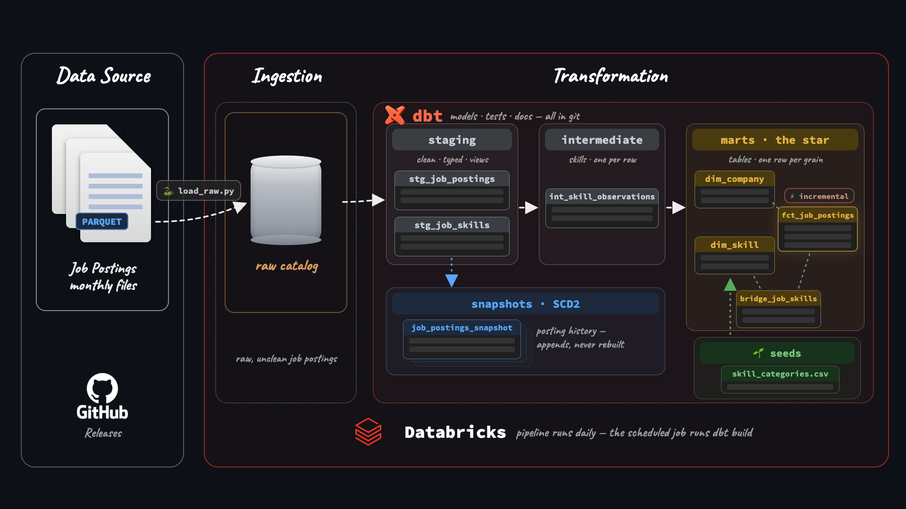
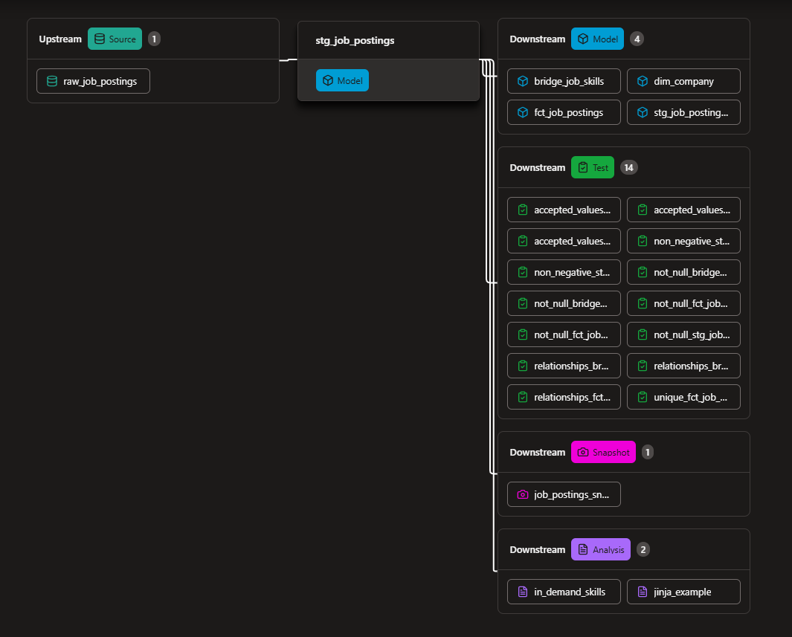
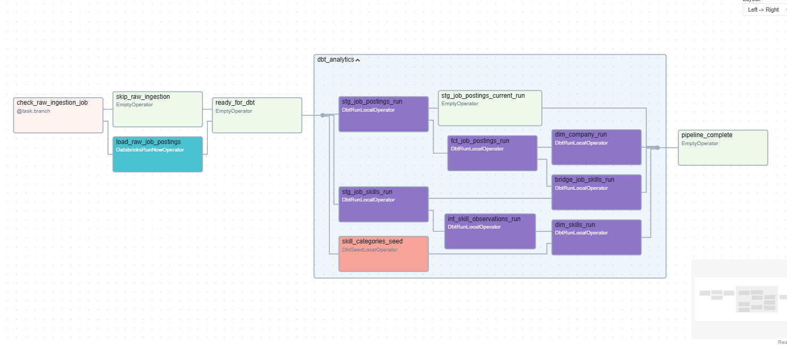

# Production Job Postings Pipeline (v2) - dbt + Databricks

[](https://abdomane.github.io/dbt-databricks-pipline/)




A production dbt pipeline on **Databricks** over 843,097 raw job-posting scrapes, rebuilt nightly by a scheduled job with zero secrets.

- Shapes medallion layers into a tested star schema — 491,140 jobs at a declared grain
- Tracks a year of salary history with SCD2 snapshots — 504,591 version rows
- Loads incrementally and runs itself on a scheduled Databricks Job — no tokens anywhere

> **v2 of this pipeline** — v1 built the foundations on DuckDB + GitHub Actions. v2 moves the same dataset to a real warehouse: Databricks, SCD2 history, incremental loads, a scheduled job.

| What I Built | How I Implemented | Where to Look |
| --- | --- | --- |
| **Star schema** | fact + dims + bridge on a declared grain | [`analytics/models/marts/`](analytics/models/marts/) |
| **SCD2 snapshots** | a year of salary history, backfilled | [`analytics/snapshots/`](analytics/snapshots/) + [`scripts/`](scripts/) |
| **Incremental fact** | merge on `job_id`, only new days load | [`fct_job_postings.sql`](analytics/models/marts/fct_job_postings.sql) |
| **Macros** | custom salary parser, column-name slugifier, and an overridden built-in | [`analytics/macros/`](analytics/macros/) |
| **Tests** | generic, singular, custom generic (`non_negative`), and unit tests | [`analytics/tests/`](analytics/tests/) + the properties YAMLs |
| **Environments** | dev/prod as catalogs: dev from the laptop, prod only from the job | Unity Catalog: `dev` + `prod` |
| **Orchestration** | scheduled Databricks Job OR granular **Apache Airflow + Cosmos** DAG | [`airflow/dags/job_postings_dag.py`](airflow/dags/job_postings_dag.py) + Databricks Workflows |
| **Analyses** | ad-hoc skill demand, Jinja loops, and snapshot history queries | [`analytics/analyses/`](analytics/analyses/) |
| **Knowledge Graph** | AST + semantic graph of the codebase & dbt lineage via Graphify | [`graphify-out/GRAPH_REPORT.md`](graphify-out/GRAPH_REPORT.md) + [`.agents/`](.agents/) |

---

## ⚙️ The dbt Pipeline

Raw scrapes flow through the medallion layers — raw → staging → intermediate → the star-schema marts — while snapshots capture history off staging. The lineage graph below is every model dbt builds:



And the dbt features doing the work:

| dbt Feature | How I Used It |
| --- | --- |
| Declared sources | `source('jobs', 'raw_job_postings')` — no hardcoded paths |
| Jinja beyond templating | benefits flags generated by a loop; one edit adds a flag |
| Custom macros | `parse_salary()` (written once, used four times) + `slugify()` (normalizes dynamic benefit column names) |
| Installed package | `dbt_utils.get_column_values()` — the roles loop in [`jinja_example.sql`](analytics/analyses/jinja_example.sql) reads the data instead of a typed list |
| Overriding a built-in | `generate_schema_name` — schemas land where the folder says |
| Seeds | [`skill_categories.csv`](analytics/seeds/skill_categories.csv) — the skill taxonomy: version-controlled reference data |
| Test-driven cleaning | `not_null` surfaced 6,255 real id-less postings; dropped with eyes open, documented |
| Singular, custom & unit tests | [`assert_salaries_sane.sql`](analytics/tests/assert_salaries_sane.sql) caught 27 typed `…–1M` salary ceilings; [`non_negative.sql`](analytics/tests/generic/non_negative.sql) guards bounds; `test_parse_salary_shape` unit-tests the salary regex |
| SCD2 snapshots | `check` strategy on 13 content columns; `searched_at` dates the versions |
| Incremental | merge on `job_id`; `is_incremental()` + a `search_date` high-water filter |
| Environments | `dev` catalog from the local profile, `prod` catalog only from the scheduled job |

`dbt build` compiles SQL, materializes models, and fails the run if any test fails — same command locally and in the scheduled job.

---

## 🚀 Production

**Databricks** owns the runtime — storage, compute, and the schedule, one platform:

- **Dev and prod as catalogs**: laptop builds land in the `dev` catalog; only the scheduled job writes the same schemas into `prod`
- **Scheduled Databricks Job** runs the whole pipeline nightly: `load_raw` (the ingest notebook), then `dbt deps` → `dbt debug` → `dbt build`, pulling the repo straight from GitHub
- **Zero secrets**: the job generates a temporary-credentials profile against the attached warehouse and revokes it after the run — no tokens in the repo, no CI secrets

Any BI tool connects straight to the warehouse — SQL editor, Excel, Power BI, and Tableau all query the `prod` catalog directly.

### 🌬️ Airflow + Astronomer Cosmos Orchestration (`airflow/`)

In addition to native Databricks Workflows, this repository includes a containerized **Apache Airflow + Astronomer Cosmos (`astronomer-cosmos`)** setup in [`airflow/`](airflow/):



- **Task-Level dbt Lineage (`DbtTaskGroup`)**: Instead of running `dbt build` as a single black-box step, Cosmos parses [`analytics/`](analytics/) and renders every seed, staging view, SCD2 snapshot, intermediate view, and mart table into individual Airflow tasks with `TestBehavior.AFTER_EACH` circuit-breaking.
- **Zero-Secret Profile Mapping (`DatabricksTokenProfileMapping`)**: Dynamically generates a temporary `profiles.yml` at runtime from Airflow's `databricks_default` connection (`AIRFLOW_CONN_DATABRICKS_DEFAULT`).
- **Isolated dbt Virtualenv**: [`airflow/Dockerfile`](airflow/Dockerfile) installs `dbt-databricks` into `/opt/airflow/dbt_venv` to prevent dependency conflicts between Airflow and dbt.

```bash
cd airflow
cp .env.example .env                     # fill in the shared JWT secret and Databricks values
docker compose up -d --build             # starts Postgres, Airflow API server (:8080), Scheduler & DAG processor
```

Generate a shared `AIRFLOW__API_AUTH__JWT_SECRET` with
`python -c "import secrets; print(secrets.token_urlsafe(48))"` and put it in `.env`.
All Airflow services must use the same value.

Airflow 3 generates a SimpleAuthManager password on startup. Read it with
`docker compose exec airflow-webserver cat /opt/airflow/simple_auth_manager_passwords.json.generated`.

Choose the dbt catalog in the Airflow UI under **Admin → Variables** by setting
`DBT_TARGET_CATALOG` to `dev` or `prod`. The first value is seeded from
`DBT_TARGET_CATALOG` in `.env` (defaults to `dev`) and is preserved on restarts.

---

## 📸 Snapshots

The marts keep each job's **latest** scrape — the snapshot table keeps **every version**, SCD2 over 13 watched columns:

- **504,591** version rows across **491,140** jobs — **10,187** jobs with real change history
- **2,756** postings changed their salary between scrapes
- Analyses on top: [`top_posting_editors.sql`](analytics/analyses/top_posting_editors.sql) (Meta edits the most postings — 415), [`salary_swings.sql`](analytics/analyses/salary_swings.sql) (a posting that went \$60K → \$1,000,000 — snapshots catch typos mid-edit), [`in_demand_skills.sql`](analytics/analyses/in_demand_skills.sql) (top skills by role), and [`jinja_example.sql`](analytics/analyses/jinja_example.sql) (dynamic `UNION ALL` across roles)

---

## 📖 Docs

Structure, tests, and column descriptions were written along the way — the docs site is a rendering of work already done:

**→ [https://abdomane.github.io/dbt-databricks-pipline/](https://abdomane.github.io/dbt-databricks-pipline/)**

The site shows:

- The full **lineage graph** (raw → staging → intermediate → the star → snapshot)
- **Model and column descriptions** from the YAMLs
- Which columns carry **tests**

The same descriptions live in the warehouse itself — `persist_docs` pushes them into Unity Catalog, so Catalog Explorer shows them right next to the data.

---

## 💻 Run it yourself

Prerequisites: a Databricks workspace (the [Free Edition](https://www.databricks.com/learn/free-edition) works) with the raw job-postings data loaded into a `raw` catalog. Then:

```bash
uv sync && source .venv/bin/activate     # env (or .venv\Scripts\activate on Windows)
cd analytics                             # switch into the dbt project directory
dbt deps                                 # macro packages (dbt_utils) — dbt_packages/ isn't committed
dbt debug                                # connection (profiles.yml holds your own host/token)
dbt build                                # models + tests + seed
dbt snapshot                             # one SCD2 pass (nightly in production)
```

Backfill a year of snapshot history in one query: paste [`scripts/backfill_job_postings_snapshot.sql`](scripts/backfill_job_postings_snapshot.sql) into the SQL editor — `dbt snapshot` takes over seamlessly afterwards.

---

## 📁 Project layout

```text
.
├── analytics/
│   ├── dbt_project.yml
│   ├── packages.yml                  # dbt_utils dependency
│   ├── models/                       # staging → intermediate → marts (the star) + sources.yml
│   ├── snapshots/                    # SCD2: job_postings_snapshot (snapshot.yml)
│   ├── seeds/                        # skill_categories.csv (the skill taxonomy)
│   ├── macros/                       # parse_salary, slugify, generate_schema_name
│   ├── tests/                        # assert_salaries_sane.sql + generic/non_negative.sql
│   └── analyses/                     # in_demand_skills, jinja_example, top_posting_editors, salary_swings
├── scripts/                          # load_raw.py (the job's ingest task) + snapshot backfill
├── airflow/                          # Apache Airflow 3 + Astronomer Cosmos Docker setup & DAG
│   ├── dags/job_postings_dag.py      # Databricks ingestion + DbtTaskGroup DAG
│   ├── Dockerfile                    # Airflow 3.1 + isolated /opt/airflow/dbt_venv
│   └── docker-compose.yml            # LocalExecutor stack (Postgres, API server, Scheduler, DAG processor)
├── docs/                             # generated static dbt documentation site (GitHub Pages)
├── graphify-out/                     # codebase & dbt lineage knowledge graph (graph.json, GRAPH_REPORT.md, graph.html)
├── .agents/                          # AI assistant rules, workflows & graphify skill
└── img/                              # README architecture & lineage assets
```

---

*Built as Project #2 of the [dbt for Data Analytics & Engineering course](https://www.lukebarousse.com) (lessons 3.01–4.02). Dataset: real job postings scraped daily, July 2025 – June 2026.*
